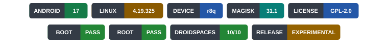
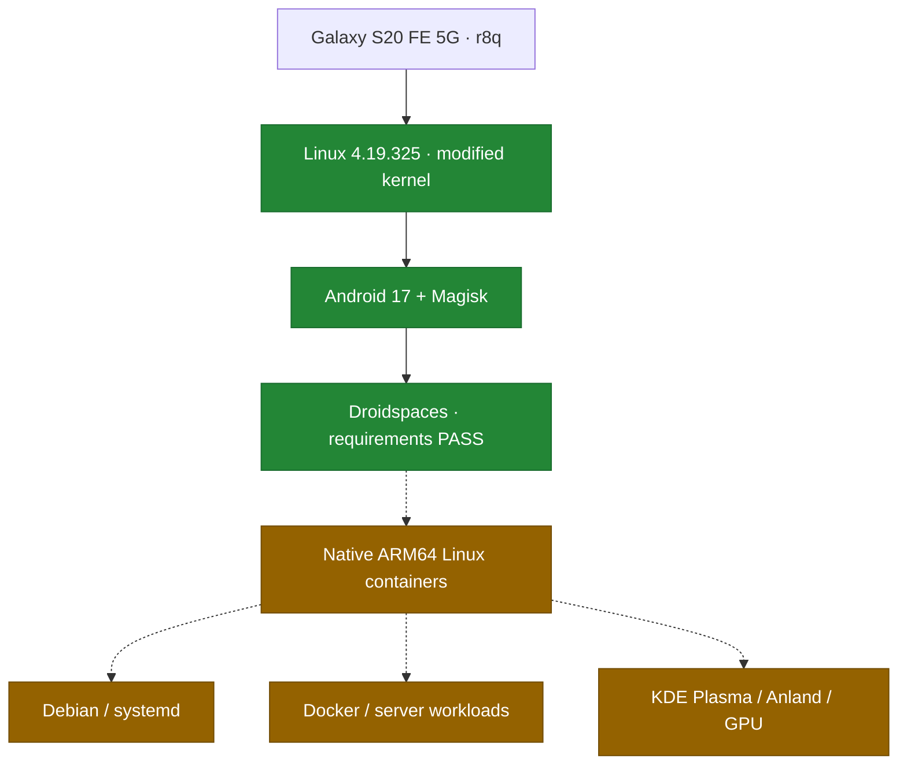
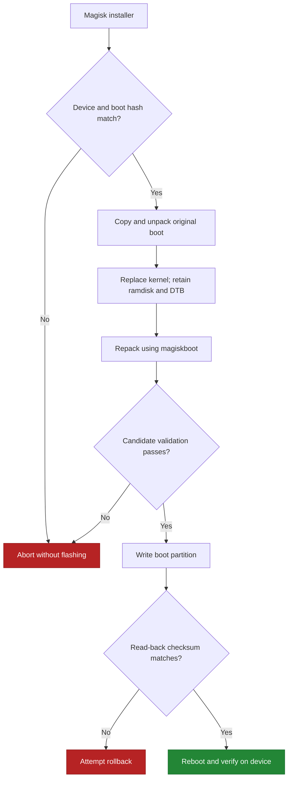

<div align="center">

# S20 FE · Droidspaces Kernel

### Android stays. Linux gets room to run.

**Samsung Galaxy S20 FE 5G · Snapdragon 865 · Android 17 · ARM64**



[Overview](#why-this-exists) · [Results](#what-changed) · [Compatibility](#compatibility) · [Install](#installation) · [Build](#build-from-source) · [Credits](#credits)

</div>

> [!IMPORTANT]
> **Boot-tested experimental release.** Android booted, root worked and all mandatory Droidspaces probes passed on one physical SM-G781B. Actual Linux container startup, Docker, GPU acceleration and desktop sessions are not yet verified. The published test installer is locked to the exact original boot partition checksum used in development; it will likely reject other users' boot images, even on the same ROM. This is not a universal flashable release.

## Why this exists

The S20 FE has a Snapdragon 865, Adreno 650 and expandable storage — a promising platform for portable Linux workloads. But the Android 17 kernel on the development phone lacked PID and IPC namespaces. Droidspaces could not start containers with that kernel.

Instead of replacing Android, this project rebuilds the matching Samsung SM8250 kernel with the required container features. The original device configuration, Magisk ramdisk and device tree are used as the baseline. The first custom build booted successfully on the development phone.



Solid paths: verified platform. Dashed paths: planned runtime tests.

## What changed

| Capability | Original | Modified |
|---|:---:|:---:|
| PID namespace | ❌ | ✅ |
| IPC namespace | ❌ | ✅ |
| System V IPC | ❌ | ✅ |
| POSIX message queues | ❌ | ✅ |
| Devtmpfs | ❌ | ✅ |
| User namespaces / sandboxing | ❌ | ✅ |
| Device cgroup (build configuration) | ❌ | ✅ |
| Mount / UTS / network namespaces | ✅ | ✅ |
| Cgroup v2 / cgroup namespace | ✅ | ✅ |
| Seccomp | ✅ | ✅ |
| FUSE / TUN / OverlayFS / EXT4 | ✅ | ✅ |
| Memory / swap limits | ✅ | ✅ |
| Mandatory Droidspaces probes | 8/10 | **10/10** |

<div align="center">


</div>

<details>
<summary><b>View every mandatory runtime probe</b></summary>

| Probe | Result |
|---|:---:|
| Root privileges | ✅ |
| Linux version | ✅ |
| PID namespace | ✅ |
| Mount namespace | ✅ |
| UTS namespace | ✅ |
| IPC namespace | ✅ |
| pivot_root | ✅ |
| /proc | ✅ |
| /sys | ✅ |
| Seccomp | ✅ |

</details>

<details>
<summary><b>Remaining limitations and what they mean</b></summary>

| Feature | Limitation |
|---|---|
| New mount API | Linux 5.2 mount APIs unavailable; modern systemd may need Droidspaces compatibility fallbacks. |
| Macvlan | No macvlan mode on compatible wired networks. |
| IPv6 NAT | IPv4 only in Droidspaces NAT mode. |
| CPU limits | Droidspaces cannot enforce the optional CPU quota. |
| Process limits | Droidspaces cannot enforce the optional PID quota. |

These five failed probes do not prevent the mandatory requirement check from passing. Docker and desktop compatibility still require independent runtime testing.

</details>

The physical device returned:

```text
Summary:
  [✓] All required features found!
Command executed (exit code: 0)
Requirements check completed successfully
```

## Compatibility

| Component | Tested configuration |
|---|---|
| Device | Samsung Galaxy S20 FE 5G |
| Model / codename | SM-G781B / r8q |
| SoC / GPU | Snapdragon 865 / Adreno 650 |
| Architecture | AArch64 (ARM64) |
| Android | 17 |
| Android build ID | CP2A.260605.016 |
| Kernel | 4.19.325-cip136-st20-perf |
| Upstream revision | `b13460286d27` (full SHA in `BASE_COMMIT`) |
| Compiler | Android Clang 22.0.2, r596125, build 15071444 |
| Magisk | 31.1 |
| Droidspaces | 7.2.0 |
| Boot layout | Header v2, 64 MiB boot partition |

> [!WARNING]
> Exynos devices and all other device variants / ROMs are untested. A matching model, Android build ID or kernel version is not sufficient to establish boot-image compatibility. Do not bypass the installer's exact boot checksum check.

## Downloads

See the **Releases** tab for the experimental v1.0.0 assets.

| Asset | Purpose |
|---|---|
| `S20FE-r8q-Droidspaces-A17-v1.0-TEST.zip` | Exact test installer used on the development device. **Strictly checksum-locked.** |
| `Kernel-Source.tar.gz` | Complete modified kernel source; build configuration in this repository. |
| `Image.gz` | Gzip-compressed ARM64 kernel for development, not directly flashable as boot.img. |
| `SHA256SUMS.txt` | Release file integrity checks. |

The release is useful to other developers as a source and configuration reference, even when the test installer rejects their boot image. No private boot images or personal device-property dumps are included.

To verify downloaded release files on Linux, place all listed assets in one folder and run `sha256sum -c SHA256SUMS.txt`.

## Installation

> [!CAUTION]
> **Do not flash without a verified independent recovery method.** This modifies the real boot partition and can cause bootloops. Back up your data and your own original boot image externally. A module removal in Magisk cannot undo this kernel replacement.

### Prerequisites

- Tested model and matching original boot partition checksum.
- Unlocked bootloader and functional Magisk root.
- An external boot backup and a recovery method that does not depend on Android starting.
- Sufficient battery and free storage; inspect the installer scripts before running them.

### Magisk installation (development configuration only)

1. Download and verify the test ZIP from Releases.
2. Open **Magisk → Modules → Install from storage** and select the ZIP.
3. Read the compatibility and repacking output. Stop if any check fails.
4. Reboot only after the installer confirms successful write and checksum verification.
5. Verify root, the new kernel and Droidspaces requirements.

The standalone preflight package is no longer distributed. Its validation is incorporated in the actual installer. The internal `preflight.sh` is required and must remain in the ZIP.



### Recovery

If Android fails to boot after a successful write, restore your own original boot image through a previously verified recovery or compatible Samsung download-mode procedure. The installer attempts rollback on a failed write/read-back, but it cannot automatically roll back a later bootloop. Never use a boot backup belonging to someone else's phone. Do not flash a raw kernel `Image` directly to the boot partition.

### Verify on the phone

In a rooted terminal:

```sh
uname -r
su -c id
su -c getenforce
su -c '/data/local/Droidspaces/bin/droidspaces check'
```

Development kernel release string:

```text
4.19.325-cip136-st20-perf-gb13460286d27-dirty
```

`-dirty` reflects the modified source tree. Check that root works and SELinux remains enforcing, and separately test Wi-Fi, cellular, Bluetooth, camera, audio, fingerprint and charging. Passing the Droidspaces check does not prove those functions or Linux userspace work.

## Technical details

The baseline configuration was exported from the running Android kernel (`/proc/config.gz`). Key newly enabled options:

```kconfig
CONFIG_PID_NS=y
CONFIG_IPC_NS=y
CONFIG_SYSVIPC=y
CONFIG_POSIX_MQUEUE=y
CONFIG_DEVTMPFS=y
CONFIG_USER_NS=y
CONFIG_CGROUP_DEVICE=y
CONFIG_NETFILTER_XT_MATCH_ADDRTYPE=y
```

The Droidspaces non-GKI cgroup prefix compatibility patch was applied. The legacy xt_qtaguid patch was skipped because its target driver was absent. SELinux, CFI, ThinLTO and module versioning configuration were retained. The exact modified source and final configuration are supplied.

Published uncompressed kernel size: **55,775,256 bytes**. SHA-256:

```text
9f33ed8de629160ae531c73996c439101a38dfae9d488129e899003cccde5080
```

## Build from source

The first build used a Manjaro VM with 12 virtual CPU threads, approximately 10 GiB RAM, six parallel jobs and Android Clang 22.0.2. It took about 20 minutes on that machine. Allow sufficient disk space and memory for ThinLTO.

### 1. Dependencies (Arch / Manjaro)

```bash
sudo pacman -S --needed base-devel git bc bison flex openssl libelf \
  ncurses cpio python perl wget curl unzip lz4 zstd rsync ccache dtc
```

### 2. Get the exact toolchain

```bash
mkdir -p clang-r596125
curl -fL --retry 5 'https://android.googlesource.com/platform/prebuilts/clang/host/linux-x86/+archive/9b144befdfd93b90e02c663504fb9f4b95f9faf8/clang-r596125.tar.gz' -o clang.tar.gz
tar -xzf clang.tar.gz -C clang-r596125
./clang-r596125/bin/clang --version
```

Expected: Android Clang 22.0.2, r596125, build 15071444. The tested host is Linux x86_64.

### 3. Build the release source

Download `Kernel-Source.tar.gz`, extract it, and run from the repository directory:

```bash
KERNEL_SRC=/absolute/path/to/s20fe-droidspaces-source \
CLANG_DIR=/absolute/path/to/clang-r596125 \
JOBS=6 bash scripts/build.sh
```

The build script uses `configs/droidspaces.config` and builds `Image` with `ARCH=arm64 LLVM=1 LLVM_IAS=1`. Output: `build/arch/arm64/boot/Image` by default. The source archive already includes the patch; do not reapply it.

Alternatively, check out the full revision in `BASE_COMMIT` from the [LineageOS SM8250 kernel](https://github.com/LineageOS/android_kernel_samsung_sm8250), apply `patches/droidspaces.patch` with `git apply --check` followed by `git apply`, and use the same build script. `DROIDSPACES_COMMIT` records the upstream patch reference. Build timestamps, host environment and Git metadata can change the output hash; bit-for-bit reproducibility is not claimed.

## Repository layout

```text
.
├── README.md
├── kernel-badges.svg
├── requirements-badges.svg
├── LICENSE
├── CREDITS.md
├── BASE_COMMIT
├── DROIDSPACES_COMMIT
├── configs/
│   ├── original.config
│   └── droidspaces.config
├── patches/
│   └── droidspaces.patch
├── scripts/
│   └── build.sh
└── installer/flash/
    ├── module.prop
    ├── customize.sh
    └── preflight.sh
```

## Roadmap

| Milestone | Status |
|---|---|
| Custom kernel compiled with matching toolchain | ✅ Complete |
| Magisk ZIP installation and Android reboot | ✅ Complete |
| Droidspaces mandatory requirements | ✅ 10/10 |
| Native Debian container / systemd | ⏳ Pending |
| Docker / Podman | ⏳ Pending |
| Adreno 650 GPU acceleration | ⏳ Pending |
| KDE Plasma Mobile and Desktop | ⏳ Pending |
| microSD container storage | ⏳ Pending |
| Broader installer compatibility | ⏳ Future work |
| Optional CPU/PID quotas, IPv6 NAT, macvlan | ⏳ Future work |

## FAQ

<details>
<summary><b>Does this replace Android with Linux?</b></summary>

No. Android remains the host. Droidspaces is intended to run Linux containers using the Android kernel.

</details>
<details>
<summary><b>Why does the installer reject my device even though it is r8q?</b></summary>

The test ZIP requires the exact original boot partition checksum from development. Magisk, ROM and boot image differences can change it. Use the source as a development reference; do not bypass the hash check.

</details>
<details>
<summary><b>Does this already support GPU-accelerated KDE?</b></summary>

Devtmpfs and user namespace checks pass. The KGSL/Mesa/display stack and actual KDE sessions still need testing.

</details>
<details>
<summary><b>Can I uninstall through Magisk?</b></summary>

Removing the module entry does not restore the kernel. Restore your own boot image using a verified recovery method.

</details>

## Credits

This project builds on the work of the open-source community.

- **[zicstardust](https://github.com/zicstardust/patches_android_kernel_samsung_sm8250_lineageOS)** — previous SM8250 community kernel work and inspiration.
- **[Original S20 FE Linux/Docker project](https://www.reddit.com/r/GalaxyS20FE/comments/1tv6fgv/i_transformed_my_s20_fe_into_a_linuxdocker_server/)** — demonstrated the potential of the S20 FE as a Linux device.
- **[Droidspaces — ravindu644 and contributors](https://github.com/ravindu644/Droidspaces-OSS)** — container runtime, kernel requirements and non-GKI compatibility patches.
- **[LineageOS](https://github.com/LineageOS/android_kernel_samsung_sm8250)** — matching base kernel source.
- **[Magisk — topjohnwu and contributors](https://github.com/topjohnwu/Magisk)** — root framework and boot image tooling.
- **Linux, Samsung, Qualcomm, LLVM and Android toolchain contributors** — kernel, device drivers and compiler infrastructure.

See `CREDITS.md` for additional acknowledgments. This project is independent and is not an official release of any upstream project.

### AI assistance disclosure

ChatGPT helped research the kernel requirements, identify the source and toolchain, prepare build and installation scripts, troubleshoot and document the project. The maintainer ran the compilation, flashed the kernel, rebooted the physical device and obtained the Droidspaces probe results. The reported tests are real hardware observations, not simulated results.

## License

The kernel retains its original GPL-2.0 licensing and individual source-file notices. The complete corresponding modified kernel source, configuration and build instructions accompany the binary. See `LICENSE` and the source archive for the original terms and notices.

---

<div align="center">

**Old hardware. New possibilities.**

Built for the Galaxy S20 FE community.

</div>
